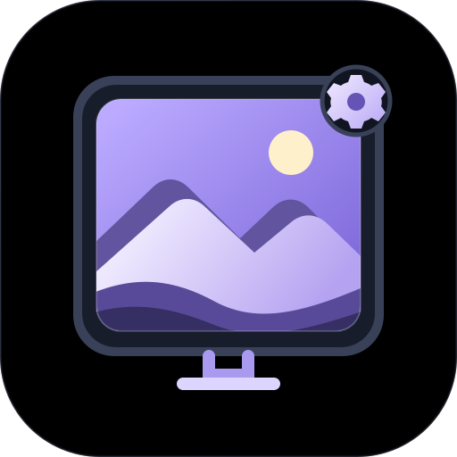
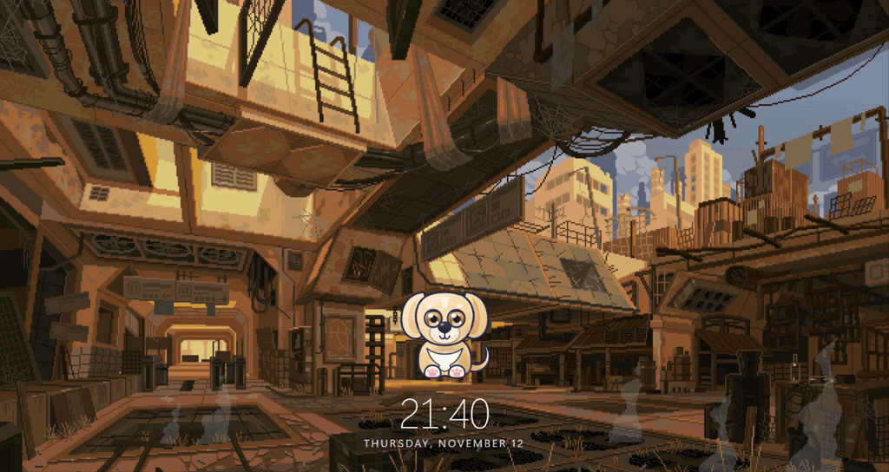
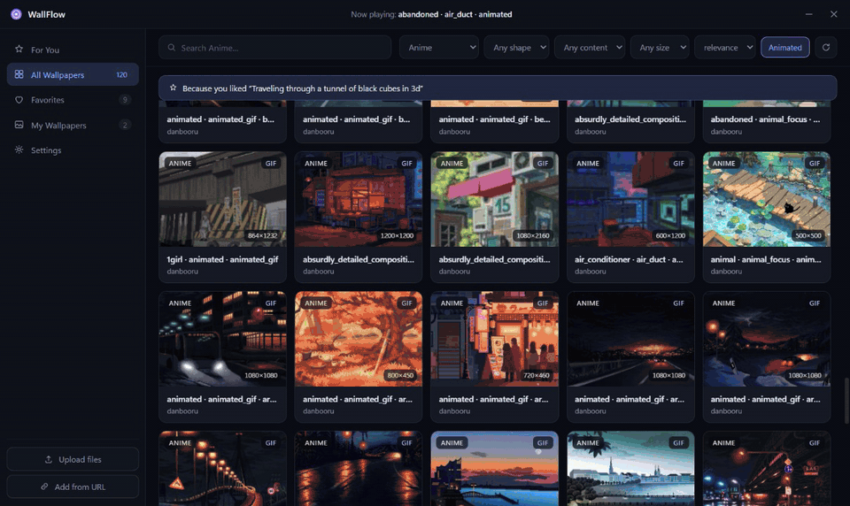
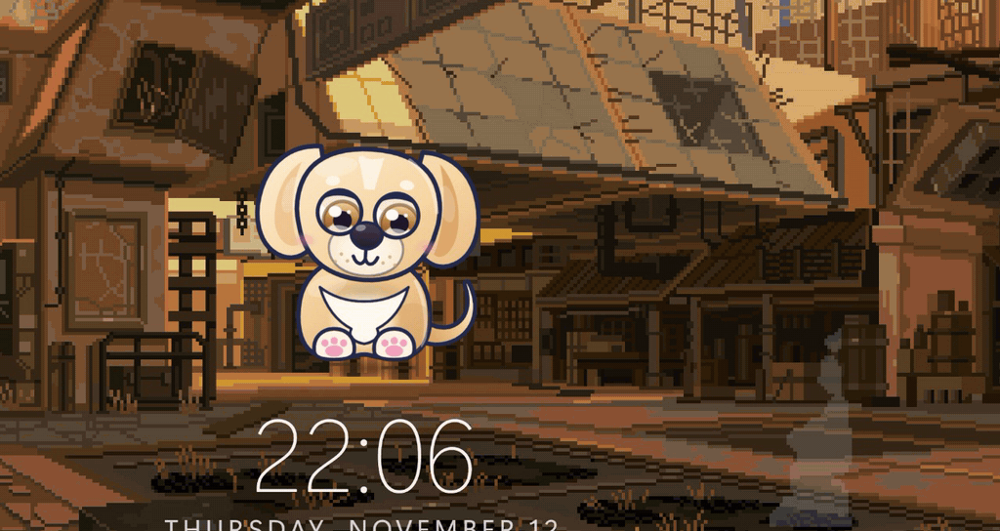

# WallFlow

**A lightweight, open source wallpaper engine for Windows.**

Animated wallpapers that play **behind your desktop icons** - with a built-in
library, a clock overlay, and a little companion that naps on your screen.

**[Download WallFlow](https://github.com/xAgesx/WallFlow-wallpaperEngine-For-Desktop/releases)**

---

## Features

- 🖼️ **Wallpapers that move** - GIFs, videos and animated scenes playing live behind your icons (which stay fully clickable, exactly as they should).
- 🔍 **One search, every source** - Wallhaven, Pexels, Unsplash, Pixabay, NASA, museum collections, anime galleries, GIF boards and community Workshop uploads, all in one library.
- 🛠️ **Share your own** - upload wallpapers to the Workshop with tags and an NSFW label; everyone gets to browse and use them after a quick review.
- 🎨 **Make it yours** - dim the image, add a vignette, show a clock & date, mouse parallax, floating particle effects.
- 🐾 **A desktop companion** - pick a cat, dog or blob. It sleeps, yawns, stretches and reacts as you move your mouse.
- 🔁 **Playlist rotation** - let wallpapers auto-swap on a timer, with optional shuffle.
- 🖥️ **Lives in the tray** - start with Windows, stop or resume anytime, and close the window without losing your wallpaper.

## ⚠️ Content disclaimer

WallFlow pulls wallpapers from third-party sites (Wallhaven, Konachan, booru galleries, GIF boards and more). Some of these sources allow **mature or explicit (NSFW) content**.

- NSFW mode is **off by default** and normal browsing filters to safe content, but no filter is perfect.
- If you turn NSFW mode on, you confirm that you are of legal age to view such material.
- You are responsible for what appears on your screen, especially in shared spaces or while recording and streaming.
- All wallpapers are served by the third-party sources themselves. The WallFlow developers have no control over them and cannot be held responsible for their content.
- Workshop wallpapers are uploaded by other WallFlow users and reviewed before they appear. Use the report flag on any card to hide something that shouldn't be there.

## Demos

| Browsing the library | Your desktop companion |
| :---: | :---: |
|  |  |

Search, filter and preview wallpapers from every source in one place, then click to apply. The companion wakes up, stretches, yawns and reacts as you move your mouse.

## Download & install

1. Grab the latest build from the **[Releases page](https://github.com/xAgesx/WallFlow-wallpaperEngine-For-Desktop/releases)**.
2. Run it. That's it - no installer, no setup.

> **Note:** The first executable build is being prepared right now - check back soon!

## Tech stack

| | |
| --- | --- |
| **Electron** | the app shell (desktop window, tray, wallpaper rendering) |
| **JavaScript · HTML · CSS** | hand-crafted UI - zero frameworks, lightweight by design |
| **PowerShell + Win32 APIs** | the trick that pins the wallpaper *behind* your desktop icons |
| **Vercel** | the API side: the key proxy and the Workshop upload service |

## License

Released under the [MIT License](LICENSE) - free to use, modify and share.
