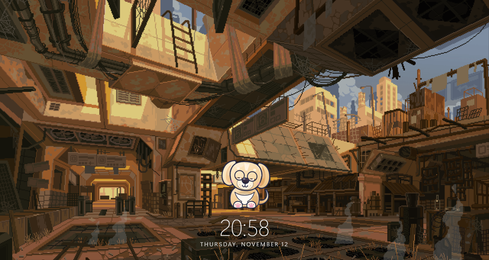
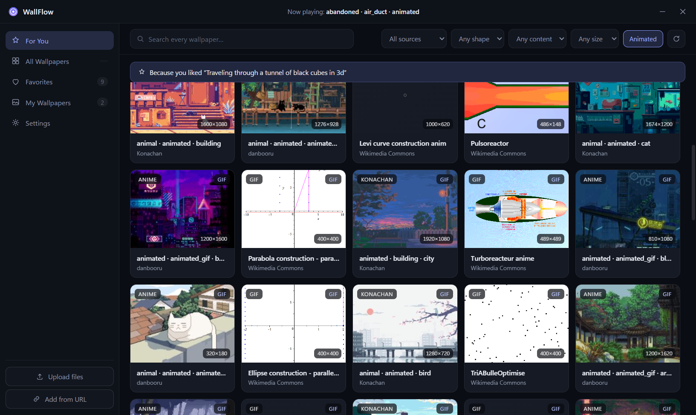

# 🌊 WallFlow

### Turn your desktop into a living scene.

Animated wallpapers that play **behind your desktop icons** - with a built-in
library, a clock overlay, and a little companion that naps on your screen.

**[⬇️ Download WallFlow](https://github.com/xAgesx/WallFlow-wallpaperEngine-For-Desktop/releases)**

---

## ✨ What can it do?

- 🎬 **Wallpapers that move** - GIFs, videos and animated scenes playing live behind your icons (which stay fully clickable, exactly as they should).
- 🔎 **One search, every source** - Wallhaven, Pexels, Unsplash, Pixabay, NASA, museum collections, anime galleries and GIF boards, all in one library.
- 🎨 **Make it yours** - dim the image, add a vignette, show a clock & date, mouse parallax, floating particle effects.
- 🐾 **A desktop companion** - pick a cat, dog or blob. It sleeps, yawns, stretches and reacts as you move your mouse.
- 🔁 **Playlist rotation** - let wallpapers auto-swap on a timer, with optional shuffle.
- 🖥️ **Lives in the tray** - start with Windows, stop or resume anytime, and close the window without losing your wallpaper.

## 📸 Screenshots

| The library |
| :---: |
|  |

Search, filter and preview wallpapers from every source in one place - then click to apply.

## ⬇️ Download & install

1. Grab the latest build from the **[Releases page](https://github.com/xAgesx/WallFlow-wallpaperEngine-For-Desktop/releases)**.
2. Run it. That's it - no installer, no setup.

> 🚧 *The first executable build is being prepared right now - check back soon!*

## 🛠 Tech stack

| | |
| --- | --- |
| **Electron** | the app shell (desktop window, tray, wallpaper rendering) |
| **JavaScript · HTML · CSS** | hand-crafted UI - zero frameworks, lightweight by design |
| **PowerShell + Win32 APIs** | the trick that pins the wallpaper *behind* your desktop icons |

## 📄 License

Released under the [MIT License](LICENSE) - free to use, modify and share.
