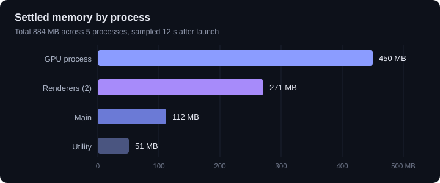
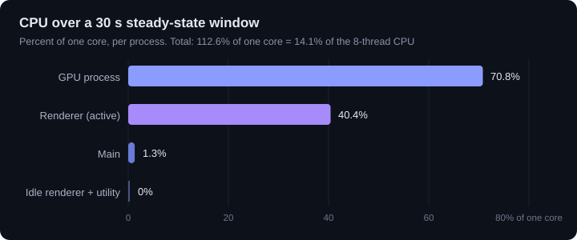
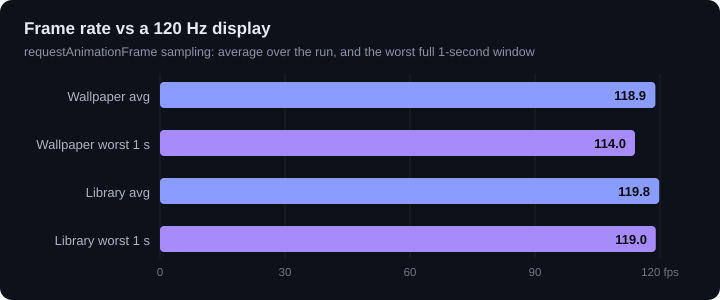
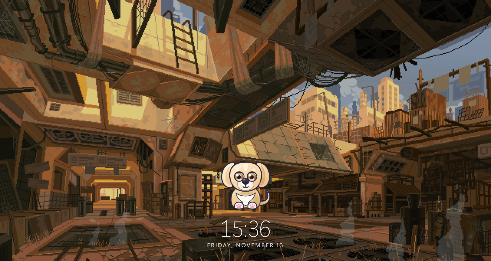
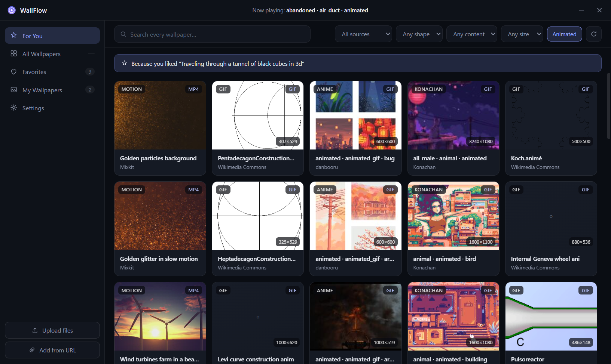

# ⚡ Performance Benchmark

A brief look at how WallFlow performs in everyday use: startup speed, memory, CPU and frame pacing. Everything below was measured on a mid-range gaming laptop, which is a realistic machine for this kind of app.

## Test machine

| | |
| --- | --- |
| CPU | Intel Core i5-10300H (4 cores / 8 threads, 2.5 GHz) |
| RAM | 16 GB |
| GPU | NVIDIA GeForce GTX 1650 Ti + Intel UHD Graphics |
| OS | Windows 11 (build 26200) |
| Display | 1920x1080 at 120 Hz |

The app was a real, running instance with the wallpaper, the clock and the companion active, inspected over the Chrome DevTools Protocol (the same tooling Chrome DevTools uses). The library window was open for the UI measurements.

## Results at a glance

| Metric | Result | |
| --- | --- | --- |
| Startup to interactive library | **1.9 - 2.2 s** | ready to click |
| Startup to fully loaded | **4.6 s** | all thumbnails fetched |
| Total memory | **884 MB** | across 5 processes |
| CPU while animating | **14.1% of the CPU** | 112.6% of one core |
| Wallpaper frame rate | **118.9 fps** (worst second: 114) | out of a 120 Hz cap |
| Library UI frame rate | **119.8 fps** (worst second: 119) | out of a 120 Hz cap |

## 🚀 Startup

Two cold launches (measured from process start):

| Milestone | Run 1 | Run 2 |
| --- | --- | --- |
| Library window present and interactive | 2.2 s | 1.9 s |
| `readyState = complete` (all thumbnails in) | n/a | 4.6 s |

Under two seconds from double-click to a usable library is the headline here. The remaining seconds are just network fetches for the wallpaper grid, which fills in progressively.

## 🧠 Memory

Settled memory, sampled 12 seconds after launch with the wallpaper animating and the library open:

| Process | RAM |
| --- | --- |
| GPU process (compositing both windows) | 450 MB |
| Renderers (wallpaper + library) | 271 MB |
| Main process | 112 MB |
| Utility process | 51 MB |
| **Total** | **884 MB** |

Just under 1 GB for an app that is driving a full-screen animated wallpaper, a thumbnail-heavy library and a companion at once. The GPU process carries the largest share, which is expected: it composites every frame of a full-screen animation on a high-DPI display. Idle renderers (the tray-hidden state) cost nothing extra.

## 🔧 CPU

Steady-state CPU over a 30 second window, while the wallpaper animates and the library sits open:

| Process | CPU (one core = 100%) |
| --- | --- |
| GPU process | 70.8% |
| Renderer (the visible animated wallpaper) | 40.4% |
| Main process | 1.3% |
| Idle renderer + utility | 0.0% |
| **Total** | **112.6% of one core = 14.1% of the CPU** |

About one-eighth of an older 4-core laptop chip is doing all the work. Two details worth calling out:

- **The main process is nearly free (1.3%)**, so the app's own logic (tray, IPC, settings, playlist timer) stays out of the way.
- **Hidden windows use zero CPU.** The renderer parked in the tray and the utility process measured exactly 0% over the window. Closing the library to the tray genuinely stops its cost.

## 🎞️ Frame rate and pacing

Sampled with `requestAnimationFrame` over 8 seconds (wallpaper) and 5 seconds (library), on a 120 Hz display:

| Surface | Average | Worst full second | Longest single frame gap |
| --- | --- | --- | --- |
| Wallpaper (animated + companion + clock) | **118.9 fps** | 114 fps | 17.7 ms |
| Library (live animated preview grid) | **119.8 fps** | 119 fps | 16.7 ms |

Both surfaces essentially saturate the 120 Hz refresh rate. The average is a hair under the cap and even the worst second stays above 114 fps, so there is no visible stutter. The longest gap (17.7 ms) equals roughly two frame intervals, meaning at most one frame was ever skipped in an 8-second stretch.

JS heap footprint during the samples: **1.7 MB (391 nodes)** on the wallpaper and **1.0 MB (4444 nodes)** in the library. Tiny, and flat over time.

## 📸 What was measured

| Wallpaper with clock + companion | The library |
| :---: | :---: |
|  |  |

## Verdict

WallFlow runs at the display's full refresh rate while eating roughly **14% of a mid-range laptop CPU** and **under 1 GB of RAM**, with a main process that idles at almost nothing. Startup is fast (under 2 seconds to a usable window), and hidden windows cost zero CPU, so keeping it resident in the tray is cheap.

### Caveats

- This is a short, informal benchmark on a single machine, not a lab study. Other hardware (weaker GPUs, 60 Hz displays, more background load) will produce different numbers.
- The app was running with the remote debugging port open, which adds a small amount of overhead to all measurements.
- Memory figures are process working sets at one point in time, not long-term leak tracking.
