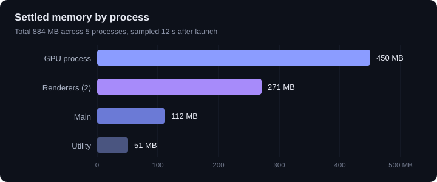
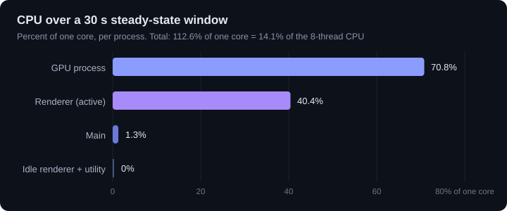
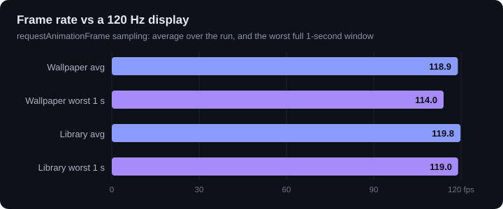

# Performance analysis

How WallFlow measures up against Wallpaper Engine (Steam), the incumbent desktop wallpaper app. WallFlow is built as a direct, free alternative to it, and the headline reason to switch is performance: Wallpaper Engine has a long-standing reputation for eating CPU, GPU and RAM, while WallFlow is designed to stay light.

## TL;DR

| | WallFlow | Wallpaper Engine |
| --- | --- | --- |
| Price | Free, open source (MIT) | Paid (US$3.29 when checked on Steam) |
| Measured RAM (running) | **884 MB total**, 5 processes | Varies widely by wallpaper type |
| Measured CPU while animating | **14.1% of an 8-thread laptop CPU** | Typically low, but widely reported to spike |
| Frame rate | **118.9 - 119.8 fps** on a 120 Hz display | Capped by user setting (24/30/60/custom) |
| Cost when idle/closed to tray | **0% CPU (measured)** | 0% only with "Stop (free memory)" rules |
| Automatic game pausing | Not yet (close to tray instead) | Yes, with per-app rules |
| Content | Online sources + your own files | 1M+ Steam Workshop items + editor |
| Startup to usable window | **1.9 - 2.2 s** (measured) | Not measured |

## The contenders

**WallFlow** is an Electron-based wallpaper engine for Windows: animated wallpapers from a built-in library of online sources or your own files, plus a clock, particles and a desktop companion. It is free and released under the MIT license.

**Wallpaper Engine** has been the standard paid answer on Steam since November 2018 (by Skutta Software GmbH). It is overwhelmingly popular: 97% positive across more than 235,000 reviews, with a Steam Workshop containing over a million wallpapers, an editor, audio-reactive and RGB integration, and an Android companion app. It is genuinely a mature, loved product, and its performance reputation is its most debated trait.

## What WallFlow costs (measured)

All numbers below were measured directly on this machine (Intel i5-10300H, 4 cores / 8 threads, GTX 1650 Ti, 16 GB RAM, Windows 11, 1920x1080 @ 120 Hz) with an animated wallpaper, the clock, the companion and the library window all active. Full methodology and raw numbers: [BENCHMARK.md](BENCHMARK.md).

| Metric | Result |
| --- | --- |
| Startup to interactive library | 1.9 - 2.2 s (4.6 s until all thumbnails loaded) |
| Total memory | 884 MB across 5 processes |
| CPU while animating | 14.1% of the CPU (112.6% of one core) |
| Wallpaper frame rate | 118.9 fps average, 114 fps worst second |
| Library frame rate | 119.8 fps average, 119 fps worst second |
| CPU with library closed to tray | 0% |

Two things worth highlighting:

- **It saturates the display.** The wallpaper holds essentially the full 120 Hz refresh rate with no stutter, while the library shows a grid of live animated previews at the same time.
- **Closing to tray genuinely stops the cost.** The tray-hidden renderer and utility process measured exactly 0% CPU over a 30-second window.

## What Wallpaper Engine costs (published and reported)

Wallpaper Engine is not installed on the test machine, so this side comes from its official Steam page, statements by its developer, and public user reports. Treat it as a profile, not a measurement on equal terms.

### What the developer claims

- Wallpaper Engine "aims to deliver an entertaining experience while using as few system resources as possible", and wallpapers automatically pause while playing games (store page).
- The developer states a GTX 1070 "will not use more than 2% - 5% for most wallpapers" (Steam discussion, July 2021).
- A "Stop (free memory)" setting fully unloads the app, "free[ing] up any RAM (aside from an absolutely tiny background process)", while a fullscreen application runs (same discussion).
- The store page is explicit that content type decides cost: "3D, 2D and video based wallpapers will perform best, while websites and applications will require more resources from your system."
- The official GPU help page explains that Task Manager inflates its GPU numbers, so perceived usage often exceeds real usage.

### Official system requirements (Steam)

| | Minimum | Recommended |
| --- | --- | --- |
| Processor | 1.66 GHz Intel i5 or equivalent | 2.0 GHz Intel i7 or equivalent |
| Memory | 1 GB RAM | 2 GB RAM |
| Graphics | Intel HD Graphics 4000+ | GTX 660 / HD7870, 2 GB VRAM |

### What users report

The reputation is not baseless. Patterns that show up repeatedly in public discussions:

- **100% CPU incidents.** An April 2025 Steam thread reports every wallpaper pinning a Ryzen 5 7600X at 100% CPU (near 90 degrees) until paused. The developer's diagnosis: the graphics card was "unavailable" due to a driver issue, so rendering fell back to the CPU. Other users in the same thread confirmed identical spikes and fixed them by reinstalling GPU drivers. When hardware acceleration degrades, Wallpaper Engine's fallback can cost an entire core.
- **Desktop and game lag.** Reports such as this r/AMDHelp thread (RX 6800 XT + Ryzen 7 5700X3D) describe desktop lag while the wallpaper runs, and performance complaints are a permanent fixture of the community discussions.
- **It is normally light, when it works.** Counter-evidence exists too: users have reported 1-3% CPU and 8-12% GPU even on "intensive interactive wallpapers", and the developer's 2-5% GPU claim matches typical simple wallpapers. The variance between "almost free" and "100% of a core" is the actual complaint.
- **Rendering continues while you game**, unless pause rules are configured. On multi-monitor setups the wallpaper keeps drawing on the second screen during games, and borderless-windowed games are not always detected, which is why the app ships a large Performance tab (FPS caps, quality presets, pause/stop rules, per-application rules).

## Why the profiles differ

| | WallFlow | Wallpaper Engine |
| --- | --- | --- |
| Stack | Chromium (Electron): renderer + GPU process | Native C++/DirectX core, embedded browser for website wallpapers |
| Wallpaper types | Images, GIFs, video from online sources or local files | Images, video, 2D/3D scenes, websites, applications |
| Cost predictability | One rendering path for everything: measured 884 MB / 14% CPU | Depends entirely on the wallpaper: simple video wallpapers are cheap, website/application wallpapers run a full embedded browser |
| Failure behavior | Measured in normal operation | If the GPU path breaks, rendering falls back to CPU (the 100% CPU reports) |

Wallpaper Engine's native core can be extremely efficient for simple wallpapers, and it is more feature-rich. But its biggest cost driver is also its biggest feature: any Workshop wallpaper can be a website, a scripted scene or an application, and those run an embedded browser or script engine whose cost the user only discovers after installing it. WallFlow renders every wallpaper through the same measured, hardware-composited path, so what was benchmarked here is what you get.

## Where Wallpaper Engine still leads

An honest comparison has to name these:

- **Game detection.** It automatically pauses or fully unloads during fullscreen apps with per-application rules. WallFlow has no equivalent yet; closing to tray costs nothing but is manual.
- **Content ecosystem.** Over a million Workshop wallpapers with an editor, audio-reactive and interactive wallpapers, RGB integration (Razer Chroma, Corsair iCUE), screensavers and an Android companion.
- **Maturity and polish.** Eight years on Steam, 97% positive reviews, and a team tuning performance options continuously.

## Verdict

Wallpaper Engine's performance problem is not that it is always heavy: in the best case it is very light, and its developer ships real performance tooling. The problem is **variance and unpredictability**: any Workshop item can spike CPU to 100%, a broken GPU driver path silently moves all rendering onto the CPU, and multi-monitor gaming keeps drawing unless rules are configured.

WallFlow's pitch is the opposite: a single rendering path with a measured, boring footprint (884 MB, 14% of a laptop CPU, full 120 fps), 0% CPU the moment it goes to the tray, a 2-second startup, and no price tag. For users who want their wallpaper to never become the reason their machine gets loud, that is the trade.

## Sources and methodology

- WallFlow figures: measured on 13 November 2026 over the Chrome DevTools Protocol on the machine described above. Raw data, charts and caveats in [BENCHMARK.md](BENCHMARK.md).
- Wallpaper Engine figures: [Steam store page](https://store.steampowered.com/app/431960/Wallpaper_Engine/) (requirements, features, developer description), [Steam discussion, July 2021](https://steamcommunity.com/app/431960/discussions/2/3048357185557204060/) (developer statements on GPU usage and the stop rule), [Steam discussion, April 2025](https://steamcommunity.com/app/431960/discussions/2/598524353315892598/) (100% CPU report and developer diagnosis), [Wallpaper Engine GPU help page](https://help.wallpaperengine.io/en/performance/gpu.html), [r/wallpaperengine usage report](https://www.reddit.com/r/wallpaperengine/comments/5wnolp/does_wallpaper_engine_use_alot_of_resources/), [r/AMDHelp lag report](https://www.reddit.com/r/AMDHelp/comments/1eiw5ci/lag_on_desktop_when_using_wallpaper_engine/).
- Wallpaper Engine was not installed on the test machine, so its numbers come from different machines under different conditions. They are directional evidence, not a lab-controlled head-to-head.
